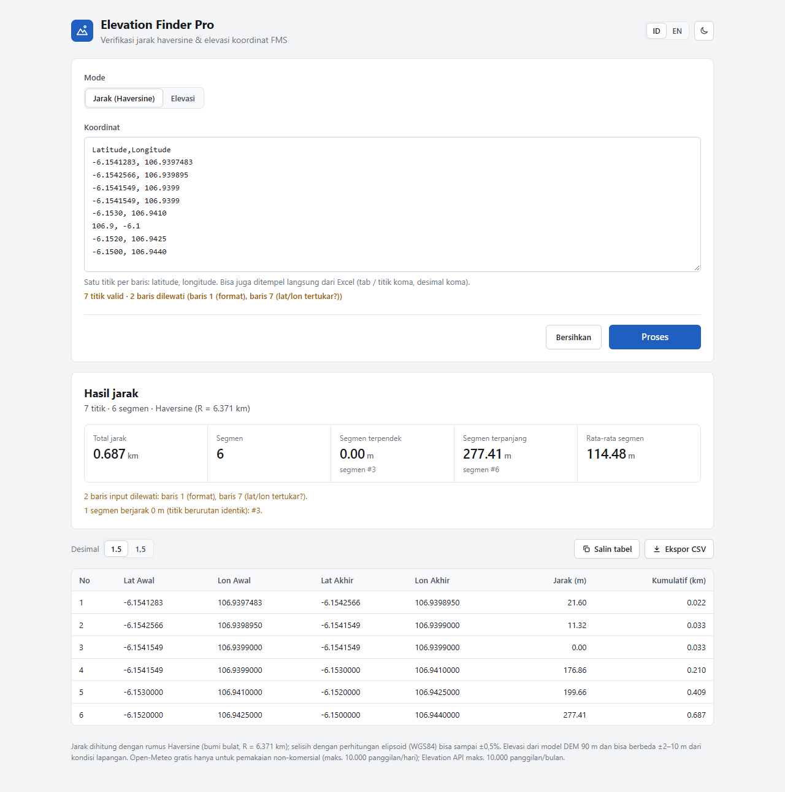
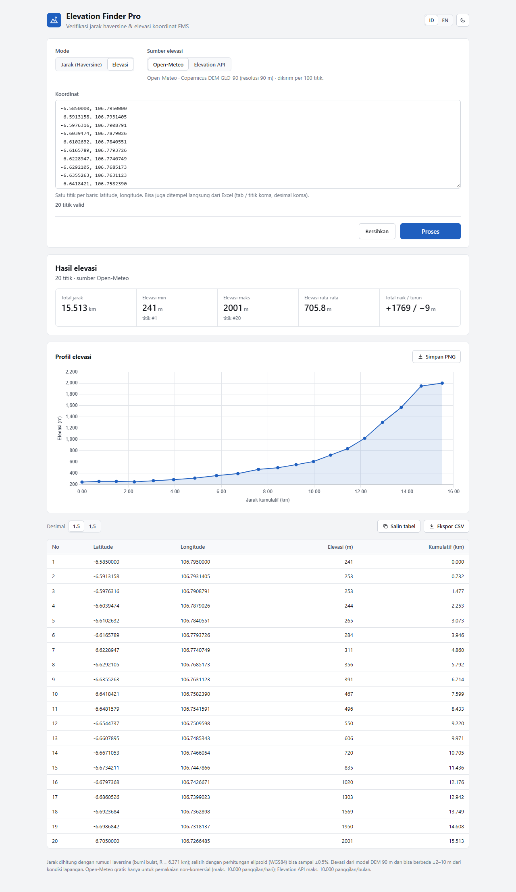
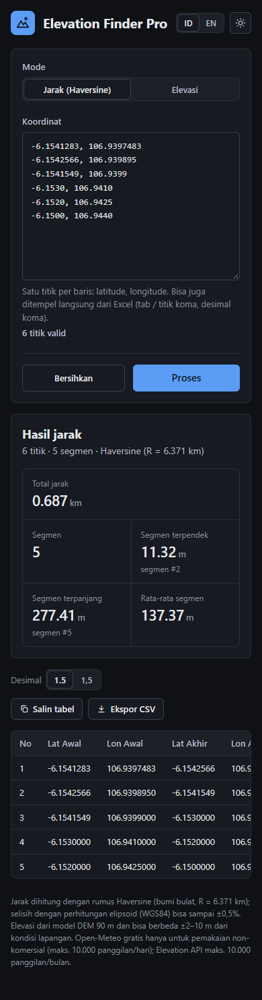

# Elevation Finder Pro

Verifikasi **jarak Haversine** dan **elevasi** dari rangkaian koordinat data mentah FMS dalam satu halaman. Tempel koordinat (langsung dari Excel pun bisa), lalu dapatkan jarak per segmen, jarak kumulatif, profil elevasi, dan tabel yang siap disalin ke Excel.

*Haversine distance and elevation check for raw FMS coordinate data. Paste coordinates (straight from Excel works), get per-segment and cumulative distances, an elevation profile, and Excel-ready tables. Static HTML/CSS/JS (ES modules), no build step, no backend, no API key.*



## Tampilan

**Mode Elevasi** dengan grafik profil elevasi (sumber Open-Meteo):



**Tema gelap di layar ponsel** (lebar 390 px):



## Fitur

- **Mode Jarak (Haversine):** jarak tiap segmen dan kumulatif, ditambah ringkasan total jarak, segmen terpendek/terpanjang, rata-rata, dan penanda segmen 0 m (titik duplikat). Berjalan sepenuhnya di browser, tanpa API.
- **Mode Elevasi:** elevasi tiap titik dari Open-Meteo (Copernicus GLO-90) atau Elevation API (SRTM GL3), dengan grafik profil elevasi yang bisa disimpan sebagai PNG.
- **Input fleksibel:** pemisah koma, spasi, tab, atau titik koma, dengan desimal titik atau koma. Kolom tambahan (waktu, ID unit) diabaikan.
- **Baris bermasalah tidak hilang diam-diam:** jumlah titik valid dan nomor baris yang dilewati beserta alasannya (format, di luar jangkauan, lat/lon tertukar) tampil langsung saat mengetik.
- **Salin tabel ke Excel** dengan satu klik, dengan pilihan pemisah desimal titik atau koma (untuk Excel berformat Indonesia).
- **Ekspor CSV** dengan format yang sama seperti versi lama.
- **Bahasa Indonesia / English** dan **tema terang / gelap**.
- Preferensi (bahasa, tema, desimal, mode, sumber elevasi) diingat per browser. Koordinat dan hasil tidak disimpan.

## Cara pakai

1. Pilih mode **Jarak (Haversine)** atau **Elevasi**. Untuk mode elevasi, pilih juga sumber datanya.
2. Tempel koordinat, satu titik per baris dengan urutan `latitude, longitude`:
   ```
   -6.1541283, 106.9397483
   -6.1542566, 106.939895
   -6.1541549, 106.9399
   ```
3. Periksa status di bawah kotak input (jumlah titik valid dan baris yang dilewati).
4. Tekan **Proses** (atau `Ctrl+Enter`).
5. Gunakan **Salin tabel** untuk menempel ke Excel, atau **Ekspor CSV** untuk mengunduh file.

Urutan baris menentukan urutan segmen: jarak dihitung dari baris ke-1 ke ke-2, ke-2 ke ke-3, dan seterusnya.

## Menjalankan

Pengguna cukup membuka link aplikasi yang sudah di-host dengan browser modern (Chrome, Edge, Firefox). Tidak perlu install apa pun.

Untuk pengembangan, buka folder ini di VS Code lalu jalankan **Live Server** (port sudah diatur ke 5502 di `.vscode/settings.json`), lalu akses `http://127.0.0.1:5502/index.html`. Server statis lain juga bisa. JavaScript-nya berupa ES modules, jadi `index.html` **tidak bisa** dibuka langsung dengan klik dua kali (`file://`), karena browser memblokir modul dari `file://`.

Deploy cukup mengunggah isi folder apa adanya (tanpa build step). Folder `arsip/` tidak perlu ikut diunggah.

Mode Jarak tetap jalan tanpa internet setelah halaman termuat. Mode Elevasi dan grafik butuh koneksi internet.

## Ketelitian

- **Jarak** memakai rumus Haversine dengan bumi dianggap bola (R = 6.371 km). Selisih dengan perhitungan elipsoid WGS84 bisa sampai ±0,5%. Cukup untuk verifikasi data FMS, tetapi bukan untuk pekerjaan geodetik presisi.
- **Elevasi** berasal dari model DEM beresolusi 90 m dan bisa berbeda ±2–10 m dari kondisi lapangan, terutama di area tambang yang permukaannya sudah berubah.

## Sumber data & batasan

| Layanan | Dipakai untuk | Catatan |
|---|---|---|
| [Open-Meteo Elevation API](https://open-meteo.com/en/docs/elevation-api) | Elevasi (bawaan) | Copernicus DEM GLO-90, 90 m. Maks. 100 titik per panggilan (aplikasi memecah otomatis) |
| [Elevation API](https://elevationapi.com) | Elevasi (alternatif) | SRTM GL3, 90 m. Satu titik per panggilan, lebih lambat |
| [Chart.js](https://www.chartjs.org) 4.4.1 via cdnjs | Grafik profil elevasi | Dimuat hanya saat dibutuhkan |

> **Penting soal lisensi Open-Meteo:** API gratis Open-Meteo hanya untuk **pemakaian non-komersial** (maks. 10.000 panggilan/hari) dan datanya berlisensi CC BY 4.0. Untuk pemakaian komersial atau di lingkungan perusahaan, gunakan [paket berbayar Open-Meteo](https://open-meteo.com/en/pricing). Lihat [syarat dan ketentuannya](https://open-meteo.com/en/terms).

## Struktur repo

```
index.html               Markup halaman
css/style.css            Semua gaya, termasuk token tema terang/gelap
js/main.js               Entry point: inisialisasi, event, alur Proses, bahasa/tema/desimal
js/core.js               State bersama, preferensi (localStorage), t(), fmt()
js/strings.js            Semua teks UI (ID/EN)
js/data.js               Parsing input, haversine, baris hasil, ringkasan (fungsi murni)
js/api.js                Sumber elevasi (Open-Meteo, Elevation API) dan pengambilan per batch
js/chart.js              Grafik profil elevasi (Chart.js)
js/render.js             Ringkasan, tabel, salin tabel, ekspor CSV
docs/SYSTEM_DESIGN.md    Desain sistem: arsitektur, alur data, keputusan desain
docs/screenshot*.png     Screenshot untuk README (jarak, elevasi, ponsel tema gelap)
arsip/                   Versi lama satu file (referensi saja, jangan dipakai sebagai dasar)
.vscode/settings.json    Port Live Server (5502)
```

Penjelasan lengkap cara kerja aplikasi ada di [docs/SYSTEM_DESIGN.md](docs/SYSTEM_DESIGN.md).

## Atribusi

- Data elevasi: [Open-Meteo.com](https://open-meteo.com), CC BY 4.0; Copernicus DEM GLO-90 © DLR e.V. 2010–2014 dan © Airbus Defence and Space GmbH 2014–2018, disediakan di bawah program COPERNICUS oleh Uni Eropa dan ESA
- Data elevasi alternatif: [elevationapi.com](https://elevationapi.com), SRTM GL3 melalui [OpenTopography](https://opentopography.org)
- Grafik: [Chart.js](https://www.chartjs.org) (MIT)
