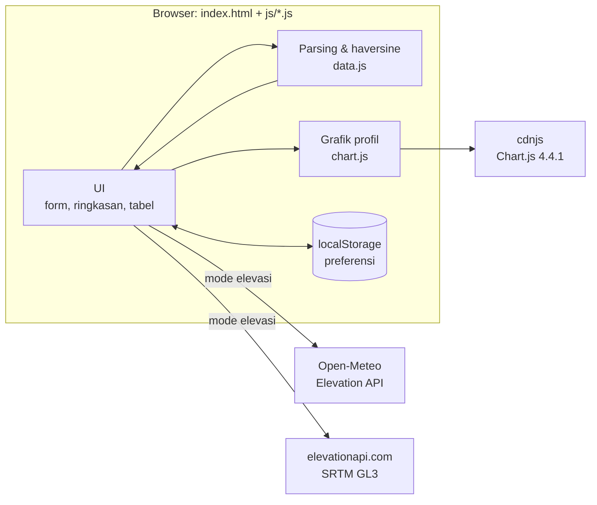
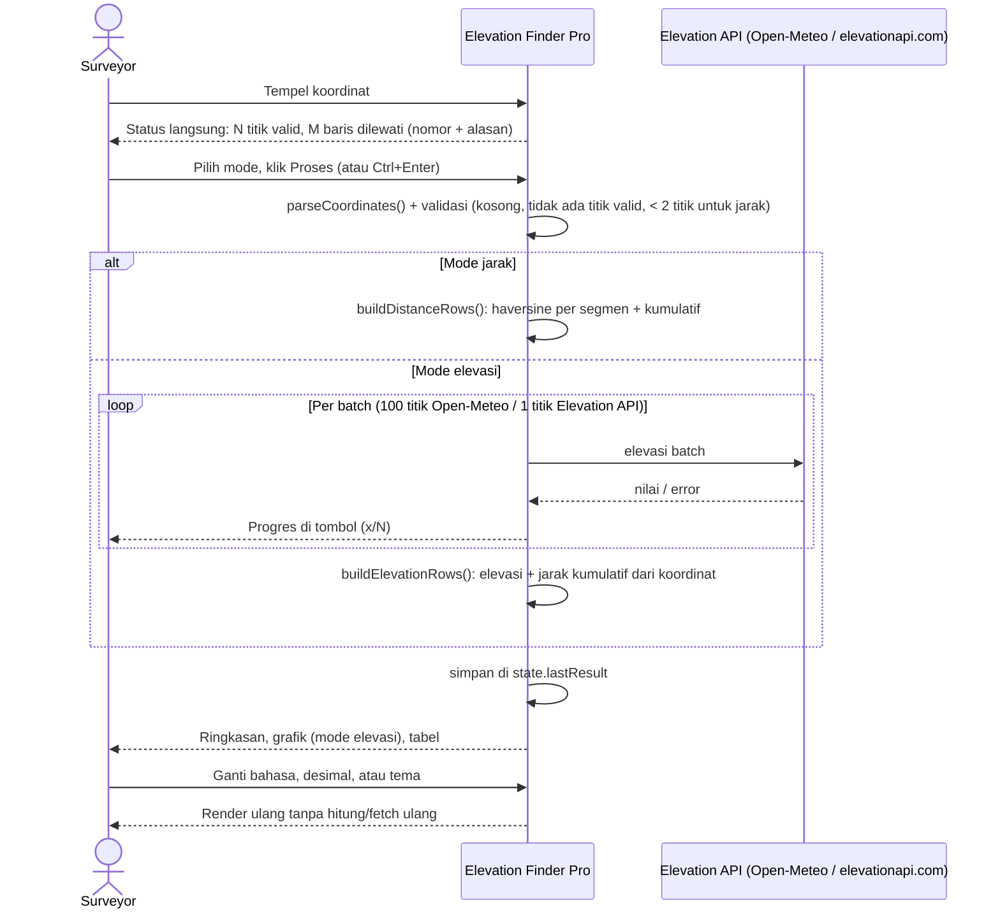

# Elevation Finder Pro: System Design

Dokumen ini menjelaskan cara kerja Elevation Finder Pro, alasan di balik tiap keputusan desain, dan batasannya. Struktur dan polanya sengaja mengikuti W-Checker (aplikasi saudara di `../w-checker`), supaya kedua aplikasi mudah dirawat dengan cara yang sama.

## Daftar isi

1. [Konteks & tujuan](#1-konteks--tujuan)
2. [Prinsip desain](#2-prinsip-desain)
3. [Arsitektur](#3-arsitektur)
4. [Alur data](#4-alur-data)
5. [Parsing input koordinat](#5-parsing-input-koordinat)
6. [Perhitungan jarak (Haversine)](#6-perhitungan-jarak-haversine)
7. [Sumber elevasi](#7-sumber-elevasi)
8. [Model data & ringkasan](#8-model-data--ringkasan)
9. [State & preferensi](#9-state--preferensi)
10. [Lapisan UI: tema, bahasa, angka, keluaran](#10-lapisan-ui-tema-bahasa-angka-keluaran)
11. [Ketahanan & mode gagal](#11-ketahanan--mode-gagal)
12. [Catatan keputusan (ADR ringkas)](#12-catatan-keputusan-adr-ringkas)
13. [Pengujian](#13-pengujian)
14. [Batasan & ide pengembangan](#14-batasan--ide-pengembangan)

---

## 1. Konteks & tujuan

**Pengguna:** surveyor di lapangan yang memverifikasi data mentah dari aplikasi FMS (Fleet Management System). FMS mencatat rangkaian titik GPS; surveyor perlu memastikan jarak antar titik dan total jarak yang dilaporkan masuk akal, lalu menempelkan hasilnya ke Excel.

**Masalah awal:** ada beberapa versi file HTML tunggal (`af.html`, `af_and_haversine.html`, `afh_mk1.html`, `afh_mk1-ultra.html`, sekarang di `arsip/`). Versi terakhir sudah bisa menghitung jarak dan elevasi, tetapi:

- baris input yang tidak terbaca dibuang diam-diam, jadi jumlah titik bisa berkurang tanpa disadari;
- kalau elevasi suatu titik gagal diambil, jarak kumulatifnya diisi angka palsu (+0,01 km);
- elevasi Open-Meteo diambil satu titik per panggilan, padahal API menerima 100 titik sekaligus;
- label "30M RES" untuk Elevation API salah (datasetnya SRTM GL3, 90 m);
- hasil hanya bisa diekspor sebagai CSV; tidak ada salin ke Excel atau pilihan desimal koma;
- satu file ±1.000 baris dengan CSS, markup, dan logika bercampur.

**Tujuan:** satu halaman yang menerima daftar koordinat apa adanya (termasuk tempelan langsung dari Excel), menghitung jarak Haversine per segmen, opsional mengambil elevasi, dan mengeluarkan hasil dalam format yang langsung bisa dipakai di Excel.

**Non-tujuan:** tidak ada login, server sendiri, atau penyimpanan data di sisi server. Bukan alat survei geodetik presisi tinggi (lihat [§6](#6-perhitungan-jarak-haversine)).

## 2. Prinsip desain

| Prinsip | Wujudnya di Elevation Finder Pro |
|---|---|
| **Nol infrastruktur** | File statis (HTML + CSS + ES modules). Tidak ada build step, backend, atau API key. |
| **Terima input apa adanya** | Pemisah koma, spasi, tab, atau titik koma; desimal titik atau koma. Surveyor tidak perlu merapikan data FMS dulu. |
| **Jujur soal data** | Baris yang dilewati disebut nomor dan alasannya. Elevasi yang gagal tampil `-`, bukan `0` atau angka karangan. Sumber dan resolusi DEM tertulis di UI. |
| **Gagal sebagian, bukan gagal total** | Batch elevasi gagal? Titik lain tetap tampil. Chart.js gagal dimuat? Tabel, salin, dan CSV tetap jalan. |
| **Format keluaran mengikuti alat kerja pengguna** | Salin tabel sebagai TSV + HTML, pilihan desimal koma untuk Excel berformat Indonesia, CSV dengan header yang tidak berubah sejak versi lama. |
| **Preferensi diingat, data tidak** | Bahasa, tema, desimal, mode, dan sumber elevasi disimpan di `localStorage`. Koordinat dan hasil tidak pernah disimpan. |

## 3. Arsitektur

Aplikasi berjalan sepenuhnya di browser. Layanan eksternal dipanggil langsung dari klien, dan hanya untuk mode elevasi; mode jarak sepenuhnya offline setelah halaman termuat.



**Susunan file.** Kode dipecah per area tanggung jawab memakai ES modules native, tanpa bundler:

| File | Isi |
|---|---|
| `index.html` | Markup: panel input (mode, sumber, textarea), area pesan, panel hasil (ringkasan, grafik, toolbar, tabel), footnote. Ditambah script kecil di `<head>` yang menerapkan tema tersimpan sebelum halaman digambar. |
| `css/style.css` | Design token di `:root`, override tema gelap, komponen, aturan responsif. Token sama dengan W-Checker. |
| `js/main.js` | Entry point: `init()`, wiring event, `processCoordinates()`, bahasa (`applyLanguage()`), tema, pemisah desimal, status input. |
| `js/core.js` | Objek `state` bersama, `readPref`/`writePref`, `t()`, `fmt()`, `fmtCoord()`, `toISODate()`. |
| `js/strings.js` | `STRINGS`: semua teks UI dalam ID dan EN. |
| `js/data.js` | `parseCoordinates()`, `haversine()`, `buildDistanceRows()`, `buildElevationRows()`, `summarizeDistance()`, `summarizeElevation()`. Fungsi murni, tanpa DOM. |
| `js/api.js` | `ELEVATION_SOURCES` (batas tiap API), `fetchElevations()`. |
| `js/chart.js` | `renderProfile()`, `destroyProfile()`, `saveProfilePng()`. Chart.js dimuat dinamis. |
| `js/render.js` | Definisi kolom tabel (`TABLES`), `displayResults()`, ringkasan, `copyTable()`, `exportCSV()`, pesan error. |

Arah ketergantungan satu arah, tanpa impor melingkar: `strings` ← `core` ← `api`/`data`/`chart` ← `render` ← `main`.

Dua aturan yang muncul karena memakai modules (sama seperti W-Checker):

- **State bersama disimpan di objek `state`** (`core.js`), bukan `let` yang diekspor, karena binding hasil `import` tidak bisa di-assign ulang dari modul lain.
- **Tidak ada atribut `onclick` di HTML.** Semua event dipasang dengan `addEventListener` di `main.js`.

## 4. Alur data



Poin penting: **hasil disimpan sekali** (`state.lastResult`). Perubahan tampilan (bahasa, pemisah desimal, tema untuk warna grafik) cukup dirender ulang dari data itu tanpa memanggil API lagi. Mengganti mode atau sumber **tidak** mengubah hasil yang sedang tampil; hasil baru muncul setelah Proses ditekan lagi.

## 5. Parsing input koordinat

`parseCoordinates(text)` membaca baris per baris. Baris kosong diabaikan tanpa dicatat. Hanya dua kolom pertama yang dipakai, jadi kolom tambahan dari FMS (waktu, ID unit, dll.) aman ikut ditempel.

| Contoh baris | Aturan |
|---|---|
| `-6.1541283, 106.9397483` | Ada koma → pisah di koma |
| `-6.1541283 106.9397483` | Tidak ada koma → pisah di spasi |
| `-6,1541283⇥106,9397483` | Ada tab/titik koma (tempelan Excel) → pisah di situ, lalu koma desimal diganti titik |
| `-6,1541283, 106,9397483` | Pola khusus "desimal koma + pemisah koma/spasi" dikenali lebih dulu |
| `-6.15, 106.94, 2026-11-09 08:00` | Kolom ke-3 dst. diabaikan |

Angka harus berbentuk desimal biasa (`/^[+-]?(\d+\.?\d*|\.\d+)$/`). Notasi lain (`1e3`, `0x10`, minus Unicode) ditolak agar tidak terbaca sebagai angka yang tidak dimaksud.

**Baris yang dilewati** dicatat dengan nomor baris dan alasannya:

| Alasan | Kondisi | Contoh |
|---|---|---|
| `format` | Tidak ada dua angka valid | baris header `Latitude,Longitude`, teks bebas |
| `swapped` | Di luar ±90/±180, tetapi akan valid kalau lat/lon ditukar | `106.9, -6.1` |
| `range` | Di luar ±90/±180 | `95, 200` |

Status ini tampil langsung saat mengetik (di bawah textarea), di pesan error kalau tidak ada titik valid, dan sebagai catatan di ringkasan hasil. Aplikasi **tidak** menukar lat/lon secara otomatis; surveyor yang memutuskan.

## 6. Perhitungan jarak (Haversine)

```
a = sin²(Δφ/2) + cos φ1 · cos φ2 · sin²(Δλ/2)
d = 2R · atan2(√a, √(1−a))        R = 6.371.000 m (jari-jari rata-rata bumi)
```

- **Segmen** = jarak titik ke-*i* ke titik ke-*i+1*, sesuai urutan baris input. *N* titik menghasilkan *N−1* segmen.
- **Kumulatif** = jumlah segmen sampai baris itu.
- Haversine stabil secara numerik untuk jarak pendek; dengan `float64`, galat pembulatan di tingkat sub-milimeter, jauh di bawah ketelitian GPS.
- **Batas model:** bumi dianggap bola. Dibanding perhitungan elipsoid WGS84 (Vincenty/Karney), selisihnya bisa sampai ±0,5% tergantung lintang dan arah. Untuk verifikasi data FMS ini cukup; untuk pekerjaan geodetik presisi tidak. Batasan ini ditulis di footnote UI.
- Rumus dan R sama persis dengan versi lama, jadi angka jarak tidak berubah setelah refactor.

**Ringkasan jarak** (`summarizeDistance`): total jarak, jumlah segmen, segmen terpendek dan terpanjang beserta nomornya, rata-rata segmen, dan daftar **segmen 0 m** (titik berurutan identik). Segmen terpanjang membantu menemukan lompatan GPS; segmen 0 m menandai titik duplikat dari FMS.

## 7. Sumber elevasi

### Batas tiap API (dicek langsung ke API, November 2026)

| | Open-Meteo Elevation | Elevation API (elevationapi.com) |
|---|---|---|
| Endpoint | `api.open-meteo.com/v1/elevation?latitude=a,b&longitude=c,d` | `api.elevationapi.com/api/Elevation?lat=&lon=&dataSet=SRTM_GL3` |
| Dataset | Copernicus DEM GLO-90 (90 m) | SRTM GL3 (90 m) |
| Titik per panggilan | **Maks. 100**; 101 membalas `{"error":true,"reason":"... must not exceed 100 coordinates."}` | 1 |
| Jeda antar panggilan di aplikasi | 100 ms | 150 ms |
| Format error | `{"error":true,"reason":"..."}` | `{"message":"..."}` |
| CORS | Ya | Ya (memantulkan `Origin`) |
| Catatan | Gratis untuk non-komersial, maks. 10.000 panggilan/hari | `SRTM_GL1` (30 m) **tidak tersedia** ("No Dataset found with this name."). Batas 10.000 panggilan/bulan berasal dari versi lama dan belum diverifikasi. |

### Cara pengambilan (`fetchElevations`)

- Titik dikirim per batch sesuai `batchSize` sumber, berurutan dengan jeda, dan progres dilaporkan ke tombol Proses.
- Batch yang gagal (jaringan, HTTP error, `error: true`) **tidak menghentikan proses**: titiknya bernilai `null`, error terakhir disimpan. Kalau semua titik gagal, error terakhir ditampilkan apa adanya, diawali nama API-nya.
- Nilai elevasi dibulatkan ke meter (`Math.round`), sama seperti versi lama. Nilai yang bukan angka hingga menjadi `null`.
- **Jarak kumulatif di mode elevasi dihitung dari koordinat**, terpisah dari berhasil-tidaknya elevasi. Ini memperbaiki bug versi lama yang mengisi +0,01 km untuk titik gagal.

## 8. Model data & ringkasan

### Baris mode jarak (satu per segmen)

```js
{ fromLat, fromLon, toLat, toLon,   // derajat desimal
  distanceM: 21.597,                 // meter
  cumulativeKm: 0.0216 }             // km
```

### Baris mode elevasi (satu per titik)

```js
{ lat, lon,
  elevation: 5,          // meter, dibulatkan; null kalau gagal
  cumulativeKm: 0.0216 }
```

### Hasil tersimpan (`state.lastResult`)

```js
{ mode: 'distance' | 'elevation',
  rows: [...],
  skipped: [{ line: 7, reason: 'swapped' }],
  sourceName: 'Open-Meteo' }   // hanya mode elevasi
```

**Aturan:** elevasi boleh `null`; semua angka tampil lewat `fmt()`, yang mengubah `null` menjadi `-`.

**Ringkasan elevasi** (`summarizeElevation`): total jarak, elevasi min/maks beserta nomor titiknya, rata-rata, total naik/turun, dan jumlah titik gagal. Titik `null` dilewati: rata-rata hanya dari nilai yang ada, dan naik/turun dihitung antar titik valid berurutan. Min/maks memakai loop, bukan `Math.min(...arr)`, supaya aman untuk ribuan titik.

## 9. State & preferensi

| State | Tempat | Isi |
|---|---|---|
| Input | `#coordinates` | Satu-satunya sumber kebenaran untuk koordinat; diparse ulang setiap kali dibutuhkan (murah) |
| Hasil | `state.lastResult` | Lihat [§8](#8-model-data--ringkasan); dipakai ulang untuk render |
| Bahasa, desimal, loading | `state.lang`, `state.decimalSep`, `state.isLoading` | Dibaca semua modul lewat `state` di `core.js` |
| Mode & sumber | Radio `mode` / `source` | Dibaca saat Proses ditekan |
| Preferensi | `localStorage` `afinder.*` | `lang`, `theme`, `decimalSeparator`, `mode`, `source` |

Pola preferensi:

- Setiap akses `localStorage` dibungkus `try/catch` (mode privat, kebijakan perusahaan). Aplikasi tetap jalan dengan nilai bawaan: bahasa ID, desimal titik, mode Jarak, sumber Open-Meteo.
- Tema diterapkan oleh script kecil di `<head>` **sebelum** CSS dan body dirender, supaya tidak berkedip.
- Koordinat dan hasil tidak disimpan. Data FMS bisa sensitif dan selalu berubah per pemeriksaan.

## 10. Lapisan UI: tema, bahasa, angka, keluaran

### Design token & tema

Token dan pola tema sama dengan W-Checker: semua warna adalah variabel CSS di `:root`, tema gelap mendefinisikan ulang variabel yang sama di `:root[data-theme="dark"]` dan di `@media (prefers-color-scheme: dark) { :root:not([data-theme="light"]) }`. Keduanya harus sinkron. Satu token tambahan: `--warn` untuk catatan baris dilewati dan segmen 0 m.

### Bahasa

Semua teks ada di `STRINGS.id` / `STRINGS.en`, dibaca lewat `t(key, params)`. Markup statis memakai `data-i18n`, `data-i18n-html`, `data-i18n-placeholder`, `data-i18n-title`, `data-i18n-aria`; `applyLanguage()` mengisi semuanya lalu merender ulang hasil. Header tabel ikut diterjemahkan; header CSV tidak (lihat di bawah).

### Angka

- `fmt(v, digits)` adalah satu-satunya jalan angka ke layar dan ke salinan tabel: menangani `null` dan menerapkan pemisah desimal pilihan pengguna.
- Koordinat memakai `fmtCoord()` (7 desimal) dan **selalu titik**, supaya tidak tertukar dengan pemisah ribuan di Excel.
- Presisi tampilan: jarak segmen 2 desimal (m), kumulatif 3 desimal (km), elevasi bilangan bulat (m).

### Keluaran

| Keluaran | Format | Mengikuti bahasa/desimal? |
|---|---|---|
| **Salin tabel** | `text/plain` (TSV) + `text/html` (tabel), cadangan `execCommand('copy')` | Ya, persis seperti yang terlihat |
| **Ekspor CSV** | Pemisah koma, desimal titik, koordinat mentah, header bahasa Inggris | **Tidak.** Format mesin yang stabil |
| **Simpan PNG** | Grafik profil dengan latar `--surface` (tidak transparan) | Mengikuti tema aktif |

**Kolom adalah kontrak** dengan template Excel/CSV pengguna, didefinisikan di satu tempat (`TABLES` di `render.js`). Jangan diubah tanpa koordinasi.

| Mode | Kolom tabel | Header CSV |
|---|---|---|
| Jarak | No, Lat Awal, Lon Awal, Lat Akhir, Lon Akhir, Jarak (m), Kumulatif (km) | `No,From Lat,From Lon,To Lat,To Lon,Distance (m),Cum. Distance (km)` |
| Elevasi | No, Latitude, Longitude, Elevasi (m), Kumulatif (km) | `No,Latitude,Longitude,Elevation (m),Cum. Distance (km),Data Source` |

Di CSV, elevasi yang gagal ditulis `N/A` (sama dengan versi lama). Nama file memakai tanggal lokal (`toISODate`), bukan `toISOString()` yang UTC.

### Grafik profil

- Chart.js 4.4.1 dari cdnjs, dimuat dinamis saat hasil elevasi pertama kali ditampilkan.
- Sumbu X **linear** dalam km kumulatif (bukan label kategori), jadi jarak antar titik di grafik proporsional dengan jarak sebenarnya.
- Garis **lurus** antar titik (`tension: 0`). Kurva halus bisa melewati nilai yang tidak pernah diukur.
- Titik gagal (`null`) tampil sebagai celah pada garis, bukan disambung.
- Warna dibaca dari token CSS, dan grafik digambar ulang saat tema berganti. Titik disembunyikan kalau lebih dari 200 agar tetap terbaca.

## 11. Ketahanan & mode gagal

| Kegagalan | Perilaku |
|---|---|
| Input kosong | Ditolak sebelum proses |
| Tidak ada titik valid | Ditolak, pesan menyebut baris yang dilewati beserta alasannya |
| Mode jarak dengan < 2 titik | Ditolak sebelum proses |
| Sebagian baris tidak terbaca | Tetap diproses; jumlah, nomor, dan alasan baris dilewati tampil di status input dan ringkasan |
| Lat/lon tertukar | Baris dilewati dengan alasan "lat/lon tertukar?"; tidak ditukar otomatis |
| Batch elevasi gagal | Titiknya tampil `-`, tidak ikut ringkasan, ada catatan jumlahnya |
| Semua elevasi gagal | Pesan error dari API terakhir, diawali nama API-nya |
| Tidak ada koneksi saat mengambil elevasi | Pesan "Gagal terhubung ke {API}" |
| CDN Chart.js gagal | Pesan di panel grafik; tabel, salin, dan CSV tetap jalan; dicoba lagi saat Proses berikutnya |
| `localStorage` tidak tersedia | Preferensi tidak tersimpan, aplikasi tetap jalan |
| Clipboard API ditolak | Cadangan `execCommand('copy')`; tombol menampilkan berhasil/gagal |
| Proses ditekan dua kali | Diabaikan selama `state.isLoading` |

## 12. Catatan keputusan (ADR ringkas)

| # | Masalah | Keputusan | Alasan |
|---|---|---|---|
| 1 | Satu file `index.html` ±1.000 baris | Pecah jadi `index.html` + `css/style.css` + 7 ES module per area, tanpa bundler | Mengikuti pola W-Checker. Konsekuensinya aplikasi harus di-host/dijalankan lewat server statis; tidak bisa dibuka dari `file://` |
| 2 | Baris tidak terbaca dibuang diam-diam | Catat nomor baris + alasan, tampilkan sebelum dan sesudah proses | Jumlah titik yang hilang tanpa disadari merusak verifikasi |
| 3 | Data dari Excel Indonesia memakai tab dan desimal koma | Parser mengenali tab/titik koma dan pola desimal koma | Surveyor bisa tempel langsung tanpa merapikan |
| 4 | Lat/lon tertukar menghasilkan titik di luar jangkauan | Dideteksi dan dilaporkan, tidak ditukar otomatis | Menukar diam-diam bisa menyembunyikan masalah di sumber data FMS |
| 5 | Jarak kumulatif +0,01 km palsu untuk titik elevasi gagal | Jarak selalu dari koordinat, terpisah dari elevasi | Jarak tidak bergantung pada API |
| 6 | Open-Meteo dipanggil per titik | Batch 100 titik per panggilan (batas dicek ke API) | ~100× lebih sedikit panggilan, jauh lebih cepat, hemat kuota |
| 7 | Label "30M RES" untuk Elevation API | Diganti "SRTM GL3 (90 m)"; GL1 30 m tidak tersedia di API | Jujur soal resolusi data |
| 8 | Hanya ekspor CSV | Tambah salin tabel TSV + HTML dan pilihan desimal koma; CSV tetap seperti versi lama | Langsung jadi sel di Excel tanpa merusak template CSV yang sudah ada |
| 9 | Grafik memakai sumbu kategori dan kurva halus | Sumbu linear km, garis lurus, celah untuk nilai kosong | Grafik tidak menampilkan jarak atau elevasi yang menyesatkan |
| 10 | Chart.js tanpa versi dari jsdelivr, dimuat di awal | Chart.js 4.4.1 dari cdnjs, dimuat dinamis dengan penanganan gagal | Versi terkunci; mode jarak tidak butuh library grafik sama sekali |
| 11 | Mode bawaan Elevasi | Mode bawaan Jarak (Haversine); pilihan terakhir diingat | Fungsi utama aplikasi adalah verifikasi jarak FMS |
| 12 | Kartu Min/Max/Avg elevasi diisi "—" di mode jarak | Kartu ringkasan khusus per mode | Ringkasan yang relevan untuk tiap mode |

## 13. Pengujian

Proyek ini tidak punya framework test. Teknik yang dipakai sama dengan W-Checker:

1. **Logika di Node.js.** `js/data.js` dan `js/api.js` di-`import` langsung dari Node (dengan `localStorage` tiruan untuk `core.js`). Skenario: semua format baris di [§5](#5-parsing-input-koordinat), baris header, lat/lon tertukar, di luar jangkauan, kolom ekstra, titik duplikat (segmen 0 m), haversine 1° lintang ≈ 111.194,9 m, 150 titik ke Open-Meteo **asli** (terpecah jadi batch 100 + 50), Elevation API asli, dan elevasi `null` di tengah rangkaian.
2. **Tampilan dengan Edge headless lewat Chrome DevTools Protocol.** Halaman dibuka dari server statis lokal dengan profil browser baru, lalu skenario dijalankan otomatis: tempel input campuran, proses mode jarak, proses mode elevasi (API asli), ganti desimal koma, bahasa EN, dan tema gelap, cek lebar 390 px tanpa scroll horizontal, lalu Bersihkan dan Proses dengan input kosong. Semua respons jaringan ≥ 400 dan error console dicatat, lalu screenshot diambil di lebar desktop dan 390 px.
3. **Regresi terhadap versi lama.** Fungsi `calculateDistance` diambil langsung dari `arsip/afh_mk1-ultra.html` dan dibandingkan dengan `haversine()` baru untuk 10.000 pasangan titik acak di sekitar Indonesia. Selisih terbesar 1,8 × 10⁻¹² m (galat pembulatan floating point), jadi angka jarak tidak berubah.

## 14. Batasan & ide pengembangan

**Batasan saat ini**
- Haversine memakai model bumi bola; selisih dengan WGS84 bisa sampai ±0,5%.
- Elevasi dari DEM 90 m (permukaan, bukan tanah terbuka), bisa berbeda ±2–10 m dari lapangan, terutama di area galian tambang yang berubah setelah data DEM diambil.
- API gratis Open-Meteo hanya untuk pemakaian **non-komersial** (maks. 10.000 panggilan/hari). Untuk pemakaian perusahaan, pakai paket berbayar.
- Mode elevasi butuh internet; mode jarak tetap jalan setelah halaman termuat.
- Tidak bisa dibuka dari `file://` (ES modules).

**Ide**
- Peta jejak titik (MapLibre + OpenFreeMap, seperti W-Checker) sebagai pengecekan visual lompatan GPS dan lat/lon tertukar.
- Ambang segmen (misalnya > X m) dengan penanda baris di tabel.
- Opsi jarak elipsoid WGS84 (Vincenty/Karney) di samping Haversine.
- Kolom kecepatan/waktu kalau data FMS menyertakan timestamp.
- Impor file CSV/XLSX langsung, selain tempel teks.
